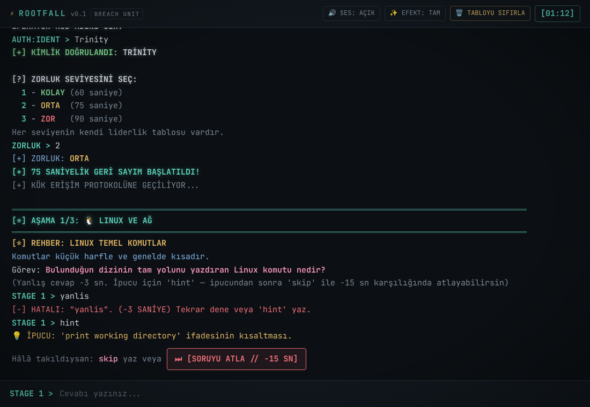
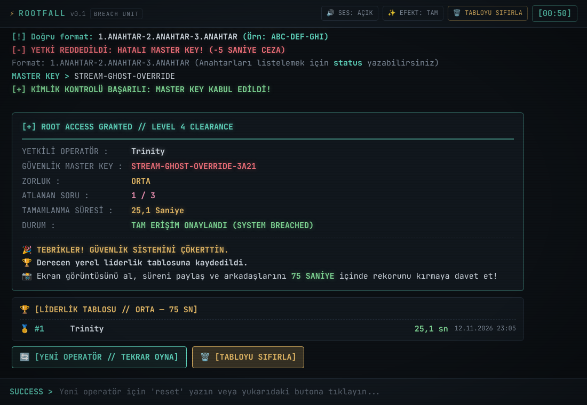

# ROOTFALL

ROOTFALL is a hacker-terminal puzzle game for the desktop. You pick a difficulty and solve 3 questions against the clock, drawn from cryptanalysis, number systems, C/C++ bug hunting, output prediction, logic gates, and Linux & networking. Each question you solve gives you a key. Use the keys to build the Master Key and break the system.

All in-game text is Turkish. The game works fully offline.





## Download and play (Windows)
1. Open the [Releases](../../releases) page and download `ROOTFALL_0.1.0_x64-setup.exe`.
2. Run it. The installer is not code-signed, so Windows may show "Windows protected your PC": choose **More info → Run anyway**.
3. Start ROOTFALL from the Start menu.

## How to play
- Type a code name, then pick a difficulty: KOLAY (60 s), ORTA (75 s) or ZOR (90 s).
- Answer each of the 3 questions. A wrong answer costs 3 seconds.
- Stuck? Type `hint`. After a hint you may `skip` the question for 10/15/20 seconds.
- Join the three keys with hyphens (`KEY1-KEY2-KEY3`) to enter the Master Key.
- `help` lists every command; `leaderboard` shows the best times on this computer.

**Status:** v0.1, a Tauri desktop app. The earlier single-file prototype (v7.0) is kept in `reference/`. If you are an agent picking up this work, start with `AGENTS.md`.

## Build from source
You need [Node.js](https://nodejs.org) (LTS). For the desktop app you also need [Rust](https://rustup.rs) and, on Windows, the Microsoft C++ Build Tools ("Desktop development with C++").

```
npm install
npm test             # rules and regression tests
npm run dev          # play in a browser: http://localhost:1420
npm run tauri dev    # run as a desktop app (the first run compiles for a few minutes)
npm run tauri build  # make the installer (src-tauri/target/release/bundle)
```

## Layout
```
AGENTS.md                      Briefing for the agent that continues the project (CLAUDE.md imports it)
docs/GAME_SPEC.md              Full gameplay spec: states, timing, rules, texts, audio, visual style
docs/DECISIONS.md              Owner feedback history, and the agreed direction
content/rootfall-content.json  126 questions, difficulty config, penalties and key words (source of truth)
src/engine/                    Game logic, independent of the UI
src/main.ts, src/styles.css    Terminal UI and theme
src/ui/audio.ts                Synthesized sounds
src-tauri/                     Desktop shell (Rust)
tests/                         Engine and content tests
reference/                     Frozen v7.0 single-file version and its checks
```

## Quick facts
- Difficulties: KOLAY 60 s, ORTA 75 s, ZOR 90 s. Skipping a question after using a hint costs 10/15/20 s.
- A wrong answer costs 3 s. A wrong Master Key costs 5 s.
- 6 categories × 3 difficulties × 7 questions. Each run uses 3 random categories, and you never get the same questions twice in a row.
- Master Key format: `KEY1-KEY2-KEY3`.
- Each difficulty has its own local leaderboard (`rootfall_lb`); times are kept to a tenth of a second.
- All in-game text is in Turkish. Everything works offline.
